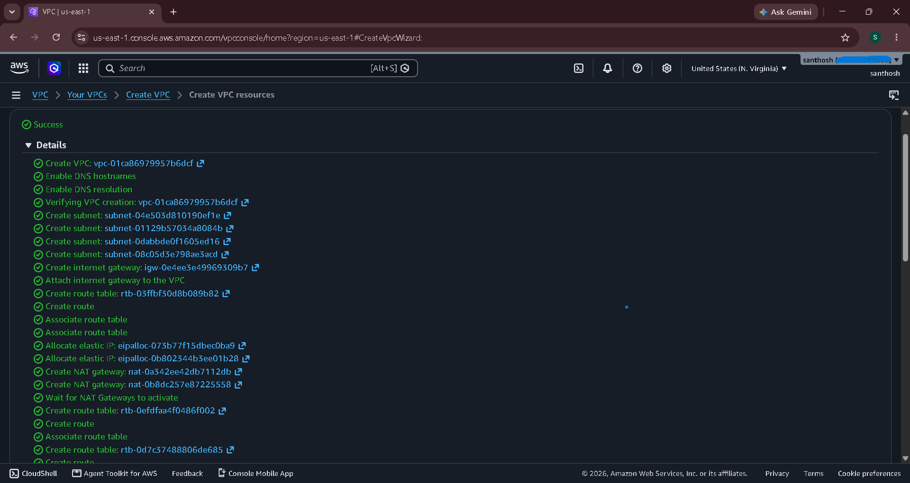
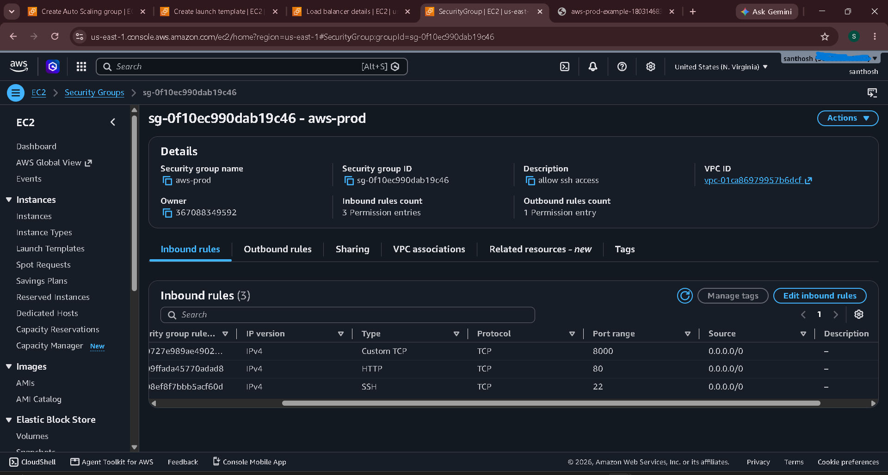
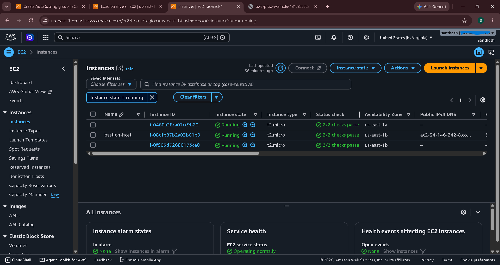
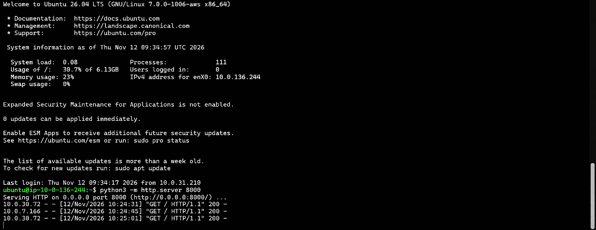
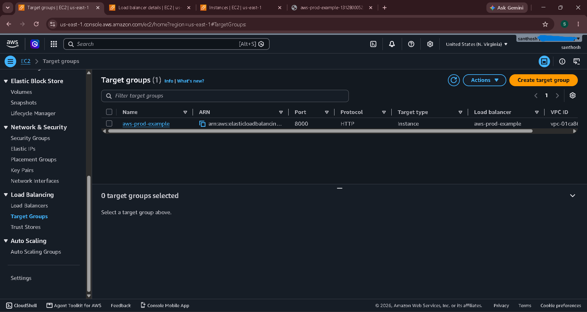
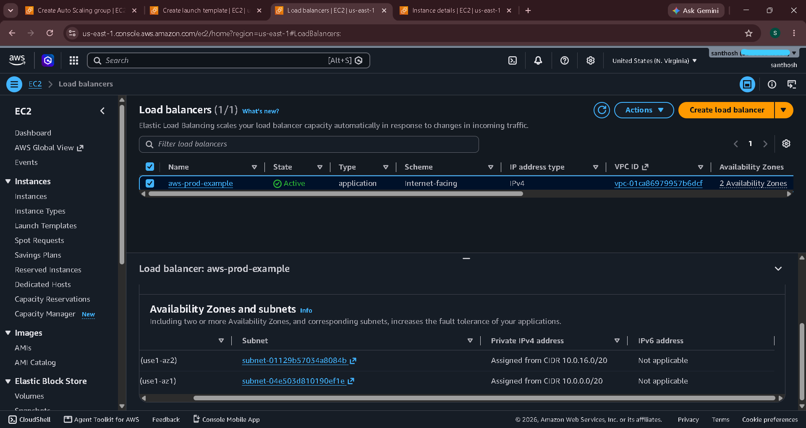
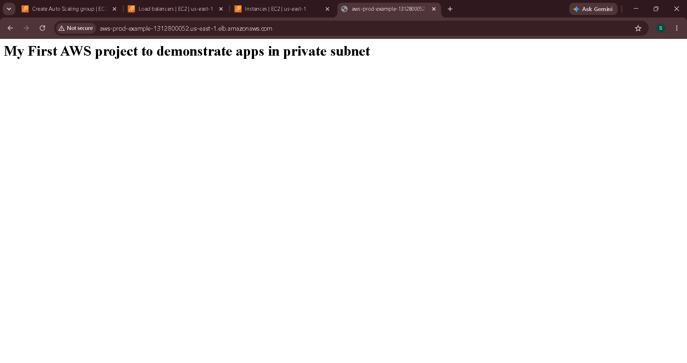
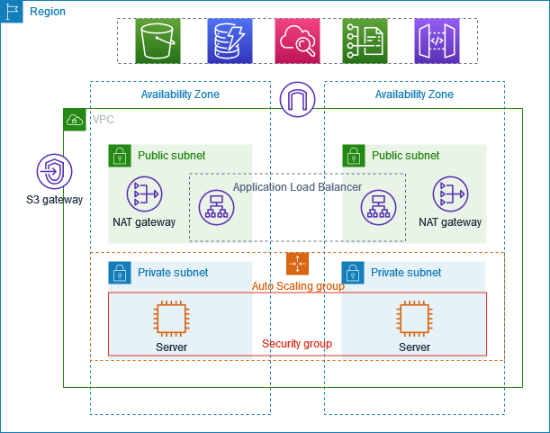

# AWS-VPC-Project
# Production-Grade AWS VPC & High-Availability Deployment

## 📋 Project Summary
This project demonstrates a secure, highly available, and scalable AWS network architecture designed for production workloads. Following AWS best practices, application servers are isolated inside **private subnets** across multiple Availability Zones (AZs) with zero direct public IP exposure. Incoming user traffic is routed securely through an **Application Load Balancer (ALB)** in the public subnet, while administrative SSH access is strictly controlled via a **Bastion Host (Jump Box)**, and outbound internet access for private instances is handled through a **NAT Gateway**.

I built a production-style AWS network: a custom VPC with public and private subnets across two Availability Zones in us-east-1. The servers run in the private subnets with no public IP, launched and managed by an Auto Scaling Group from a Launch Template. Users reach them only through an internet-facing Application Load Balancer in the public subnets, and I reach them for setup only through a bastion host. NAT gateways give the private servers outbound internet access.

To prove the setup works, I wrote a simple index.html file and served it with Python's built-in web server (python3 -m http.server 8000) on a private instance. Opening the load balancer's DNS name in the browser displayed that page.

Outcome: a page served publicly through the load balancer while the servers stay isolated from the internet.

---

## What is a VPC?

A Virtual Private Cloud (VPC) is your own isolated network inside AWS. You pick its IP range, divide it into subnets, and control which traffic may enter or leave. Every AWS account gets a default VPC for getting started, but real projects should use a custom VPC like this one, so the network layout and security rules are chosen on purpose.

## VPC Components Used in This Project

- **VPC:** isolated network for all resources, with DNS hostnames and DNS resolution enabled
- **Subnets:** 4 in total across us-east-1a and us-east-1b: 2 public (load balancer, bastion, NAT gateways) and 2 private (web servers)
- **Internet Gateway:** connects the public subnets to the internet
- **NAT Gateways + Elastic IPs:** let private instances make outbound requests without being reachable from the internet
- **Route Tables:** the public table routes to the Internet Gateway; private tables route to the NAT gateways
- **Security Group (`aws-prod`):** instance-level firewall allowing ports 22, 80, and 8000
- **Launch Template:** blueprint for the servers: Ubuntu AMI, `t2.micro`, key pair, security group
- **Auto Scaling Group:** launches and maintains 2 instances across the private subnets
- **Bastion Host:** EC2 instance in a public subnet used to SSH into the private instances
- **Target Group:** sends requests to the private instances on port 8000, with HTTP health checks
- **Application Load Balancer:** receives public traffic on port 80 and forwards it to the target group

## Architecture

```text
                        [ Internet Users ]
                                │
                                ▼
                     [ Internet Gateway (IGW) ]
                                │
        ┌───────────────────────┴───────────────────────┐
        ▼                                               ▼
┌───────────────────────┐                       ┌───────────────────────┐
│   Public Subnet (AZ1) │                       │   Public Subnet (AZ2) │
│                       │                       │                       │
│  • Application LB     │                       │  • Application LB     │
│  • NAT Gateway + EIP  │                       │  • NAT Gateway + EIP  │
│                       │                       │  • Bastion Host       │
└───────────┬───────────┘                       └───────────┬───────────┘
            │ (HTTP: 8000)                                  │ (SSH: 22)
            ▼                                               ▼
┌───────────────────────┐                       ┌───────────────────────┐
│  Private Subnet (AZ1) │                       │  Private Subnet (AZ2) │
│                       │                       │                       │
│  • EC2 App Instance   │◄── Auto Scaling ─────►│  • EC2 App Instance   │
└───────────────────────┘       Group           └───────────────────────┘
```

**Traffic flow:** User → Internet → Application Load Balancer (public subnets) → Target Group (port 8000) → EC2 web servers (private subnets).

**Admin access:** Admin → SSH → Bastion host (public subnet) → SSH → private EC2 instance.

## Implementation

### Step 1: Create the VPC with "VPC and more"

In the VPC console, chose **Create VPC → VPC and more** and configured:

- 2 Availability Zones
- 2 public subnets and 2 private subnets (4 subnets in total, across us-east-1a and us-east-1b)
- NAT gateways with Elastic IPs for the private subnets
- No IPv6
- S3 VPC endpoint set to Non

The creation workflow finished with Success : VPC, subnets, Internet Gateway, route tables, Elastic IPs, and NAT gateways were all created.

VPC workflow success


### Step 2: Create the security group and EC2 launch template

Created the `aws-prod` security group with these inbound rules:

- **Port 22 (SSH):** access to the bastion and, from it, the private instances
- **Port 80 (HTTP):** load balancer listener
- **Port 8000 (Custom TCP):** port where the Python web server runs on the private instances


Note: SSH is open to 0.0.0.0/0 for this demo. In production, restrict it to a specific IP or to the bastion only.

Then created an EC2 Launch Template with an Ubuntu AMI, t2.micro instance type, my key pair, and the aws-prod security group.

Launch template



### Step 3: Create the Auto Scaling Group

Created an **Auto Scaling Group** from the launch template, selected the new VPC, and placed the instances in the **private subnets**, with desired and minimum capacity of 2. The group launched 2 private instances automatically.


### Step 4: Launch the bastion host

Launched an EC2 instance named **bastion-host** in a public subnet, with a public IP and SSH access. Together with the 2 instances from the Auto Scaling Group, the account shows 3 running instances, all with 2/2 status checks passed.




### Step 5: Reach the private instance and create the web page


Copied the `.pem` key file to the bastion host using `scp`:

```bash
scp -i <key.pem> <key.pem> ubuntu@<bastion-public-ip>:/home/ubuntu/
```

Then SSH'd into the bastion, and from the bastion SSH'd into the private instance using its private IP:

```bash
chmod 400 <key.pem>
ssh -i <key.pem> ubuntu@<private-instance-ip>
```

On the private instance, created the page and started the web server:

```bash
vi index.html            # write a simple HTML page
python3 -m http.server 8000
```

Writing `index.html` and starting the server on port 8000 (the terminal shows the private IP `10.0.136.244`):


After the load balancer was in place, the server logs showed `GET / 200` responses, which confirms the private instance is serving the page without a public IP.



### Step 6: Create the target group and Application Load Balancer

Created the target group aws-prod-example (HTTP, port 8000, target type Instance) with HTTP health checks, and registered the private instances.

Target group
Created the target group `aws-prod-example` (HTTP, port 8000, target type Instance) with HTTP health checks, and registered the private instances.

Then created an internet-facing **Application Load Balancer** `aws-prod-example`. In the wizard, I selected the VPC and the **public** subnets (the screenshot shows the us-east-1a public subnet, `10.0.0.0/20`, whose route table points to the Internet Gateway), then chose the security group and attached the target group on listener port 80.

Create Application Load Balancer wizard

> Note: the wizard starts with the `default` security group selected. I replaced it with `aws-prod`, and selected the public subnet in both AZs (us-east-1a and us-east-1b). The finished load balancer below confirms both.

Its state is **Active**.





### Step 7: Verify the result


Copied the load balancer's DNS name into the browser. The page I wrote in index.html loaded successfully, served from the private subnet.




## Key Takeaways

- A VPC with "VPC and more" creates the subnets, gateways, and route tables in one go, across two AZs for availability
- Private instances have no public IP, so a **bastion host** is the controlled way in for SSH
- A **NAT gateway** gives private instances outbound internet access without exposing them
- An **Auto Scaling Group** with a launch template keeps the desired number of servers running
- An **ALB and target group** route public traffic to the private servers



## Clean Up

To avoid charges, delete the load balancer, target group, Auto Scaling Group, launch template, bastion host, and NAT gateways, release the Elastic IPs, and then delete the VPC.


